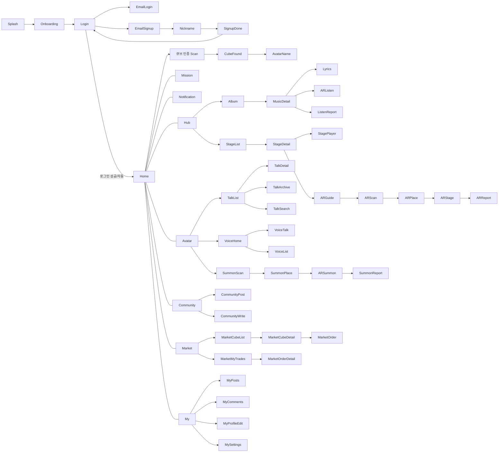

# ARZONE — 화면 정의서

> 단일 씬(Phone.unity) 내 패널 전환 방식 · ScreenManager가 켜고 끔 · 기준 캔버스 412×893
> 뒤로가기: 히스토리 스택이 아닌 **고정 부모 맵**(BackMap) — 아래 각 화면의 "←" 표기
> 모든 레이아웃은 디자이너 시안(Figma export SVG/PNG) **실측값** 기반

## 0. 화면 지도 (전체 흐름)

## 1. 인증·온보딩

| 화면 ID | 역할 | 주요 구성 | 이동 | ← | 연동 |
|---|---|---|---|---|---|
| Splash | 로고 노출 후 자동 전환 | 로고(logo_arzone) | →Onboarding/Login | — | — |
| Onboarding | 소개 3장 슬라이드 | 이미지 3장·점 인디케이터(활성 13×8 알약 #6FE8F5) | →Login | Login | — |
| Login | 로그인 허브 | 이메일 버튼(가입 이력에 따라 문구·목적지 전환), SNS 자리 | →EmailLogin/EmailSignup, 토큰 있으면 자동 →Home | — | 자동 로그인 |
| EmailLogin | 이메일 로그인 | 이메일/비번 입력(형식 검증·보기 토글) | 성공→Home | Login | POST login/email |
| EmailSignup | 회원가입 1 | 이메일/비번/약관 | →Nickname | Login | — |
| Nickname | 회원가입 2 | 닉네임(카운터)·프로필 3종 선택(링 표시) | 성공→SignupDone | EmailSignup | POST signup |
| SignupDone | 가입 완료 | 완료 연출 | →Login | Login | — |
| PasswordReset / ResetSent | 비번 재설정 | 폼/완료 | | EmailLogin | — |
| Permission | 권한 안내 | 카메라·마이크 등 | | Nickname | — |

## 2. 온보딩 큐브(피규어) 인증

| 화면 ID | 역할 | 주요 구성 | 이동 | ← | 연동 |
|---|---|---|---|---|---|
| Scan | **실물 피규어 인식** | 카메라 + 스캔 프레임(321×328) + **실루엣 가이드(항상 표시)** + 진행바(실제 인식률, 단조 증가) | 인식→CubeFound | Home | Vuforia+자체검증(01_기능명세 4장) |
| ScanFail | 인식 실패 안내 | 재시도/코드 입력 | | Scan | — |
| CodeInput | 인증 코드 입력 | 4칸 + 커스텀 키패드 + 제한시간 | 성공→CubeFound | Scan | POST cubes/verification |
| CodeFail | 코드 실패 | | | CodeInput | — |
| CubeFound | 인증 성공 | "RUBY CUBE를 찾았어요!" | →AvatarName | Scan | — |
| AvatarName | 아바타 이름 설정 | 닉네임 입력 + 선택 프로필 반영 | →Home | Avatar | — |

## 3. 홈·허브·상단 기능

| 화면 ID | 역할 | 주요 구성 | 이동 | ← | 연동 |
|---|---|---|---|---|---|
| Home | 메인 홈 | 3D 아바타(412×412 무대, **앉아 턱괴기**)·인사말 로테이션·D-day("131 Days with Jennie", 보라 #936AFC)·친밀도 카드(216프레임 진행바)·탭바 | 상단: Mission/Notification, 카드→IntimacyDetail, 탭바→Community/Market/My, 아바타→Avatar, Hub | (시작점) | GET home |
| Hub | 콘텐츠 허브 | 탑바(홈과 동일 타이포)·4분할 카드(유리 발광 테두리)·AR FAB(펼침형) | →Album/StageList/ARGuide | Home | GET home |
| Avatar | 아바타 홈 | 무대에 선 아바타(키 54%·발 27% — 시안 실측)·원형 버튼 3·미션/알림 | →TalkList/VoiceHome/SummonScan | Home | — |
| Mission | 미션 목록 | 친밀도 헤더·일일/이벤트 미션 카드(보상받기/바로가기) | 바로가기→기능별 화면, 보상→연출 | Home | GET missions |
| Notification | 알림 | 탭 필터·읽음 처리·카드 탭 이동 | | Home | — |
| IntimacyDetail | 친밀도 현황 | 레벨·경험치·주간 그래프(7등분)·혜택 카드 | | Home | 홈 값 |
| LevelUp / LevelUpResult / BadgeReward | 보상 연출 | 레벨별 아트워크 | | Mission | — |
| BadgeCollection | 뱃지 도감 | 격자+필터 칩+상세 시트 | | My | — |

## 4. 대화

| 화면 ID | 역할 | 주요 구성 | 이동 | ← | 연동 |
|---|---|---|---|---|---|
| TalkList | 텍스트 대화 목록 | 행 372×101(스와이프 삭제)·무제목은 "새 대화" | →TalkDetail/TalkArchive/TalkSearch | Avatar | GET sessions(TEXT) |
| TalkDetail | 대화 상세 | 말풍선 코드 생성(아바타 #A855F7 / 내 것 #0F0D17)·타이핑 점(18×7)·입력바(키보드 리프트·캐럿)·사진 첨부·보관/신고 | 이탈 시 세션 종료(GPT 제목) | TalkList | 메시지 송수신 |
| TalkArchive | 보관함 | 보관 텍스트 카드 | | TalkList | GET archive |
| TalkSearch | 대화 검색 | 검색바·최근 검색 칩·전 세션 메시지 검색 | | TalkList | 세션 전체 로드 |
| VoiceHome | 음성 대화 홈 | 아바타 카드(**앉아 턱괴기 클로즈업**)·새 대화 시작·주제 추천 3장·최근 목록 | →VoiceTalk/VoiceList | Avatar | GET sessions(VOICE) |
| VoiceTalk | 음성 통화 | 상태 3단계: Idle(인사+주제)/Listen(듣는중+파형)/Spoken(하단 **자동 크기 라운드 상자**에 내 말) · 응답은 상단 대사 교체 + TTS 재생·립싱크 | 종료 모달→VoiceHome | VoiceHome | STT(로컬)+메시지 API+TTS |
| VoiceList | 음성 대화 전체 | 행(재생·파형·길이)·스와이프 삭제 | | VoiceHome | GET sessions(VOICE) |

## 5. 미디어 (앨범·무대)

| 화면 ID | 역할 | 주요 구성 | 이동 | ← | 연동 |
|---|---|---|---|---|---|
| Album | 앨범 | 커버·트랙 목록(TrackRow) | →MusicDetail | Hub | GET album |
| MusicDetail | 음원 상세 | 재생/진행바(SeekBar)·세그먼트(일반/AR)·다음 곡·가사 보기 | →Lyrics/ARListen | Album | 스트리밍+세션 |
| Lyrics | 가사 | LRC 싱크 강조·따라 스크롤·재생/일시정지 | | MusicDetail | 로컬 LRC |
| StageList | 무대 목록 | 대형 카드+목록·MV/콘서트 탭(보라 알약)·1줄 말줄임 | →StageDetail | Hub | GET stages |
| StageDetail | 무대 상세 | 인라인 플레이어(공유 VideoPlayer·재생/일시정지·3초 자동숨김)·추천 목록·AR 모드 토글 | →StagePlayer/ARGuide | StageList | 스트리밍+세션 |
| StagePlayer | 가로 전체화면 | 가로 전환(OrientationSwitcher)·동일 컨트롤 | | StageDetail | 공유 플레이어 |
| StageLoading | AR 무대 로딩 | 큐브 시퀀스+진행바 | →ARStage | StageDetail | — |

## 6. AR

| 화면 ID | 역할 | 주요 구성 | 이동 | ← | 연동 |
|---|---|---|---|---|---|
| ARGuide | AR 가이드 | 진입 경로별 3모드(첫인식/무대AR/소환) — 문구·좌표 스왑 | →ARScan | StageDetail | — |
| ARScan | 공간 스캔 | 스캔 애니메이션(150프레임)·실제 평면 검출 대기 | 검출→ARPlace | ARGuide | ARCore |
| ARPlace | 배치 | 탭 배치·드래그 이동·회전 | →ARStage | ARScan | — |
| ARStage | AR 무대 재생 | 공간 고정 스크린·재생 컨트롤·촬영 | →ARReport | StageDetail | 세션·캡처 업로드 |
| ARReport | 관람 리포트 | 캡처 카드(비율 유지)·저장 | | StageDetail | — |
| ARListen | AR 음원 감상 | 립싱크 아바타(가사 게이트)·가사 3줄·미니 플레이어·촬영 | →ListenReport | MusicDetail | SPECIAL 세션 |
| ListenReport | 감상 리포트 | 캡처·다시재생·나가기 | | MusicDetail | — |
| SummonScan | 소환 공간 스캔 | ARScan과 동일 구성(경로만 다름) | →SummonPlace | Avatar | ARCore |
| SummonPlace | 아바타 배치 | 탭 배치 — 배치 순간 **V사인 포즈** | →ARSummon | SummonScan | 소환 세션 시작 |
| ARSummon | 소환 촬영 | 아바타+프레임(예절샷)·촬영·더블탭 이동 | 종료→SummonReport | Avatar | 사진 업로드 |
| SummonReport | 소환 리포트 | 오늘 찍은 사진·저장 | | ARSummon | — |

## 7. 갤러리·사진

| 화면 ID | 역할 | 주요 구성 | 이동 | ← | 연동 |
|---|---|---|---|---|---|
| Gallery | 갤러리 | 2열 마소너리(폭 178·간격 16)·탭 4(전체/캡처/앨범/스틸컷)·선택 삭제 | →CaptureDetail(사진 상세) | 진입점 기억 | GET/DELETE gallery |
| CaptureDetail/PhotoDetail | 사진 상세 | 원본 비율(FitContain)·**AR에서 다시 경험하기**(캡처류만) | →해당 AR 화면 | 진입점 기억 | ar-experience |
| TodayPhotos | 오늘 사진 | 2열 고정 격자(178×267)·선택→저장 시트(ARZONE/기기) — 시트 열림 시 하단 여백 자동 확보 | | 진입점 기억 | 저장 |

## 8. 커뮤니티

| 화면 ID | 역할 | 주요 구성 | 이동 | ← |
|---|---|---|---|---|
| Community | 목록 | 카드 373×223(뱃지·제목·본문 2줄·작성자[내 글=프로필 닉네임]·♥/댓글)·검색·정렬 토글(최신↔오래된, 화살표 회전)·칩·탑바 **내 프로필 아이콘**·글쓰기 | →CommunityPost/CommunityWrite | Home |
| CommunityPost | 글 상세 | 작성자(내 글=내 프로필)·본문 전문·사진(커버 크롭)·댓글(아바타=작성자 프로필)·댓글 입력(캐럿·리프트·PointerDown 전송)·⋮ 팝업 | | Community |
| CommunityWrite | 글쓰기 | 게시판 칩·제목/본문(캐럿)·사진 첨부 시트(3열·5장)·등록 검증 토스트 | 등록→Community | Community |

## 9. 마이

| 화면 ID | 역할 | 주요 구성 | ← |
|---|---|---|---|
| My | 마이페이지 | 프로필(아바타·닉네임 = ProfileStore)·내 글/댓글 수(실집계)·설정·로그아웃/탈퇴 모달(토큰 삭제→Login) | Home |
| MyPosts / MyComments | 내가 쓴 글/댓글 단 글 | 커뮤니티 카드 공유(빌더 재사용)·피치 239 | My |
| MyProfileEdit | 프로필 편집 | 아바타 3종 선택·닉네임(캐럿)·저장 토스트 | My |
| MySettings | 설정 | 토글 7(PlayerPrefs 영속) | My |

## 10. 마켓

| 화면 ID | 역할 | 주요 구성 | ← |
|---|---|---|---|
| Market | 마켓 홈 | 카드 178×250·내 프로필 아이콘 | Home |
| MarketCubeList | 큐브 목록 | 카드(판매자·상태·가격) | Market |
| MarketCubeDetail | 상품 상세 | 사진 캐러셀+인디케이터·판매자 | MarketCubeList |
| MarketOrder | 주문 확인 | 배송지 변경 시트(입력·리프트)·결제 모달 — 거래 생성 | MarketCubeDetail |
| MarketMyTrades | 내 거래 내역 | 행(칩·썸네일·가격) | Market |
| MarketOrderDetail | 주문 상세 | 단계 타임라인·구매 확정 | MarketMyTrades |
| MarketPurchaseDone | 구매 확정 완료 | 블록체인 증명 펼침(network·tokenId·txHash…) | Market |

## 11. 공통 오버레이 (화면 미등록 — OpenSheetButton으로 열림)
Sheet_ImagePicker(사진 선택) · Sheet_CommunityPhoto · Sheet_MarketAddress(배송지) ·
Sheet_Report(신고 3종 사유+상세) · Modal_Logout/Withdraw/PostDelete/ArchiveDelete ·
Popup_PostMenu(⋮) · Toast(하단 372×46) — 스와이프/여백 탭 닫기 공통.
