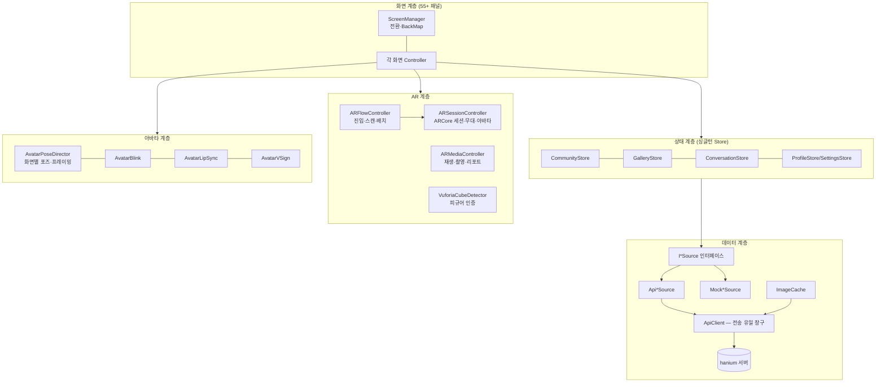

# ARZONE — 프론트엔드 시스템 아키텍처

> Unity 6000.3.17f1 · URP · Android IL2CPP (GameActivity) · 작성 2026-08-31

## 1. 기술 스택

| 층 | 선택 | 비고 |
|---|---|---|
| 엔진 | Unity 6000.3.17f1 + URP 17.3 | 단일 씬(Phone.unity) 패널 전환 |
| AR (공간) | AR Foundation 6.6 + ARCore | 평면 인식·앵커 — 소환/무대/감상 |
| AR (사물 인식) | Vuforia Engine 11.4.4 | Model Target — 실물 피규어 인증 |
| 아바타 | UniVRM (VRM 1.0) + MToon URP | 표정(Expression)·스프링본 |
| 음성 입력 | Android SpeechRecognizer (JNI 직접 브리지) | 플러그인 無, ko-KR |
| 네트워크 | UnityWebRequest + JsonUtility | 콜백/코루틴 (async 미도입 — 의도) |
| 로컬 저장 | PlayerPrefs | 토큰·프로필·설정 |

## 2. 모듈 구조



### 핵심 규칙
- **화면은 URL·JSON을 모른다** — 인터페이스만 본다. Mock 교체로 오프라인 개발 가능.
- **Store는 OnChanged 이벤트**로 화면 갱신 — 목록/상세가 같은 데이터를 본다.
- **DTO와 앱 모델 분리** — 서버 필드 변경 시 변환 함수 한 곳만 수정.

## 3. 화면 전환·내비게이션
- ScreenManager가 패널 SetActive 토글, `ScreenChanged` 이벤트 발행(포즈·입력필드 스윕 등이 구독).
- **뒤로가기 = 고정 부모 맵(BackMap 55항목)** — 히스토리 스택 폐기(무한 루프 방지, 08-31 결정).
  갤러리 상세류 4화면만 "진입점 기억" 예외.

## 4. AR 파이프라인

### 4-1. 카메라 소유권 (핵심 제약)
**Vuforia와 ARCore는 동시에 카메라를 못 쓴다.** 피규어 인증(Vuforia)은 온보딩 전용으로 격리하고,
화면 이탈 시 ARCamera를 꺼서 이후 AR 흐름(ARCore)에 카메라를 넘긴다.

### 4-2. 실물 피규어 인증 (자체 검증 계층)
```
Vuforia Model Target(8cm 피규어, MTG 5/5) — 추적/포즈
  └ 자체 검증 (VuforiaCubeDetector)
     ① 2.5s 연속 TRACKED     ② 카메라↔대상 거리 흔들림 ≤5cm (15% 트림)
     ③ 머리~발끝 화면 내      ④ 다리 구역 픽셀 vs 배경 색차(최대값) ≥ 임계
  UX: 실루엣 가이드(내장 오버레이 텍스처 탈취→프레임 내 고정 표시) + 실측 진행바(단조 증가)
```
좌표계 특성(실측): 월드 중심=카메라 고정·1유닛=1cm → 모든 측정을 **대상 로컬 상대좌표·미터 정규화**로 수행.

### 4-3. AR 콘텐츠 흐름
- 무대: 평면 검출(GroundPlaneScanner) → 탭 배치(StagePlacement) → 공간 고정 VideoPlayer.
  한 번 배치한 무대는 화면을 오가도 유지(AR 영역 완전 이탈 시에만 정리).
- 소환: 배치 시 아바타 인스턴스 생성(높이 정규화·스킨 바운드 매프레임 갱신 — 컬링 소실 방지),
  V사인 포즈, 더블탭 이동, 예절샷 프레임 합성 촬영.
- 감상: 카메라 앞 1.2m 아바타 + LRC 게이트 립싱크.
- 촬영: UI 1프레임 숨김 → RT 캡처(URP+AR에서 CaptureScreenshotAsTexture null 이슈 우회,
  sRGB 정합) → 앱 갤러리(서버 업로드) / 기기 갤러리.

## 5. 아바타 파이프라인
- **VRM 1.0** 모델, 무대(AvataStage) 하나를 RT_Avatar로 촬영해 각 화면 RawImage가 표시.
- **포즈**: 애니메이션 에셋 없이 휴머노이드 본 FromToRotation 정적 포즈
  (앉아 턱괴기·스탠딩·환영·V사인 — 손가락 관절 단위 제어). 프레이밍은 뼈 기반 자동
  (모델 교체에도 구도 유지 — 시안 실측 비율로 파라미터화).
- **표정**: blink(자동 깜빡임 2~5s)·aa(립싱크 — 오디오 RMS / TTS). 셰이프키는 Blender 제작 후
  VRM 바이너리 직접 바인딩 보정으로 연결.
- **성능**: 189만 트라이앵글 모델 실측 30fps 고정(Adreno 840) — FpsProbe(5초 주기 logcat)로 검증.

## 6. 미디어 파이프라인
- **음원**: MusicPlayer(DontDestroyOnLoad)가 AudioSource 소유 — 화면 전환에도 재생 유지.
  서버 스트리밍(streamAudio, 압축 상태로 곡당 ~3MB 캐시) + 로컬 폴백.
- **영상**: 공유 VideoPlayer를 런타임 상시 호스트("StageVideoHost")에 두고 상세/전체화면/AR이
  같은 재생 상태를 이어받는다. 로컬 즉시 재생 → 서버 URL 도착 시 같은 위치로 교체.
- **가사**: LRC 파서(LyricsController) — 현재 줄 강조·따라 스크롤·립싱크 게이트 공용.

## 7. 입력·음성
- 입력 필드: 전역 스윕(InputFieldTuner)으로 인라인 편집·커스텀 캐럿 통일.
  런타임 생성 필드는 textComponent 배선 후 재초기화(캐럿 미생성 TMP 특성 대응).
- 키보드: decorView 가시 영역 실측(LiftWithKeyboard) — TouchScreenKeyboard.area 기기 편차 우회.
- STT: SpeechRecognizer 인스턴스 재사용(cancel→start) — 세션마다 파괴/재생성 시
  서비스 연결이 끊겨 오류(5/11)가 나는 문제를 구조적으로 제거. 일시 오류는 0.6s 자동 재시도 2회.
- TTS: 대화 응답 audioUrl 재생 + 무대 아바타 립싱크 연동.

## 8. 디자인 시스템
- DesignTokens(색·타이포 토큰) + TokenStyle(인스펙터 바인딩) — 색 하드코딩 금지.
- 시안 실측 워크플로: Figma SVG/3x PNG → svgmeasure/fontsize 도구로 수치화 → 코드/씬에 숫자로 반영.
- 유리(glass): backdrop-blur 부재 → 정점 그라디언트(GlassGradient) + 발광 부분 테두리(GlassEdgeGlow,
  밝기(u,v)=TL·(1-u)(1-v)+BR·uv) 런타임 부착(GlassGlowBoot).

## 9. 품질·검증 체계
- 씬 YAML 직접 편집 + `arb.py verify`(중복 0·잘림 0·미해결참조 0) + 자동 백업.
- Unity 없이 Roslyn 직접 컴파일 검증(Bee rsp 재활용).
- 실기 검증: adb logcat 태그 규약([Api]/[CubeScan]/[FPS]/[Speech]…) + 스크린캡처 시안 대조.
